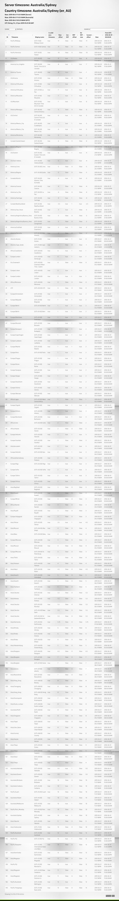

Timezone CFC
========================================

# What

CFC & function to help you convert a time from a timezone to another timezone

# Why

### For Adobe ColdFusion or very early version of Lucee

Because Adobe ColdFusion lack a proper timezone date time calculation builtin function, you can use this CFC to help you.

### You don't need this for Lucee v4.5 and up

In Lucee, DateTimeFormat() and ParseDateTime() functions support a timezone argument and you can acheive the conversion by:
```
  // Convert a server time (as it is on server timezone) to London time
  londonTime = DateTimeFormat( now(), "yyyy-mm-dd HH:nn:ss", "Europe/London" );

  // Convert a time as it is on London timezone to a time on server timezone (assume server timezone is New_York)
  serverTime = ParseDateTime( date="2025-10-11 13:17:30", timezone="Europe/London" ) // result is {ts '2025-10-11 08:17:30'}
```

# How

- timezone.cfc - A CFC provides timezone information and convert date/time between timezones, originally developed by Paul Hastings (<paul@sustainableGIS.com>)
- timezone.sql - A sql dump file consists of the common timezones we usually find in a application dropdown or operating system settings (the full timezone list in JAVA is too much)

### Convert date/time from server timezone to UTC
If we want to set the created date / updated date of a database record in UTC, we can get the UTC time by using the builtin CF function DateConvert
```
  utc_now = DateConvert( "local2Utc", now() );
  record.setValue("createdAt", utc_now);
```
Or we can use the MySQL function UTC_TIMESTAMP
```
  SET createdAt = UTC_TIMESTAMP()
```

### Convert date/time from UTC to a Timezone
Now database record's createdAt is stored in UTC timestamp, to display the date/time in a particular timezone, use the function CastFromUTC
```
  tz = createObject("component","timezone");
  timezoneTime = tz.CastFromUTC( record.getValue("createdAt"), "US/Eastern" );
  writeoutput( "The record is created on #timezoneTime# (US/Eastern time)" );
```

### Convert date/time from server timezone to a Timezone
The function CastFromServer is the one to use. Useful when you want to convert now() (the current time at the server timezone) to a date/time in a particular timezone
```
  tz = createObject("component","timezone");
  timezoneNow = tz.CastFromServer( now(), "US/Eastern" );
  writeoutput( "The time now in US/Eastern is #timezoneNow#" );
```

### Timezone info
What we can get from using timezone.cfc, the timezones are from timezone.sql


